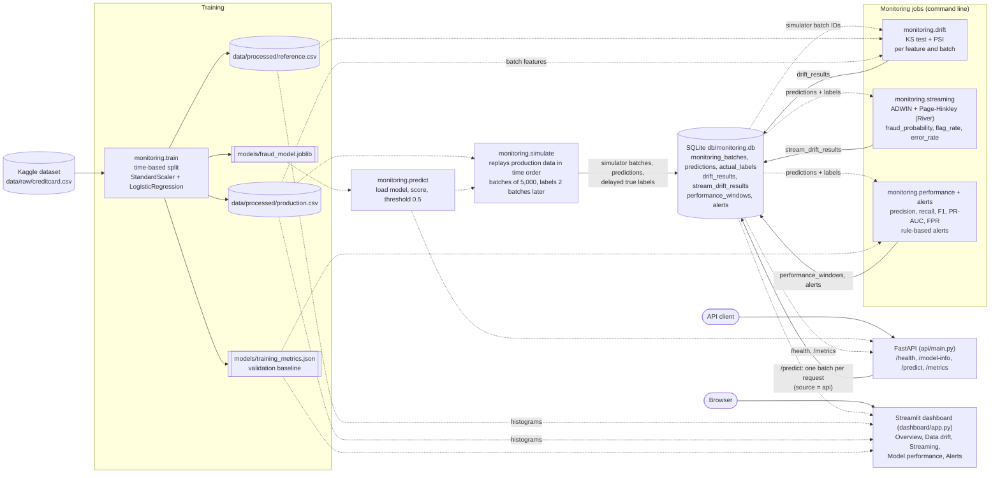
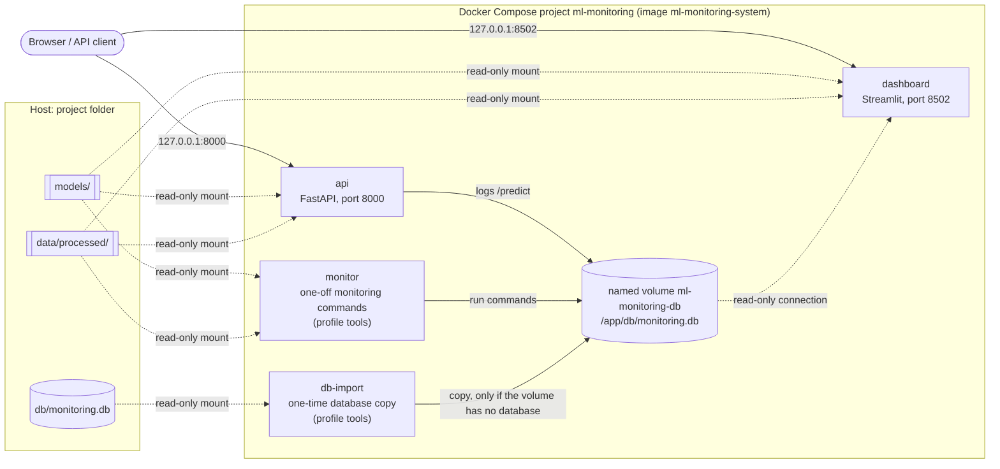

# ML Monitoring & Drift Detection System

A credit card fraud detection model together with the system that watches it
in production: every prediction is logged, input data is checked for drift,
model outputs are monitored transaction by transaction, performance is
measured once the (delayed) true labels arrive, alerts are raised, and
everything is shown in a dashboard and served through an API.

| Part | What it does | Code |
|---|---|---|
| Training | StandardScaler + LogisticRegression (balanced classes), time-based split | `src/monitoring/train.py` |
| Production simulator | Replays held-out transactions in time order, logs predictions, releases true labels later | `src/monitoring/simulate.py` |
| Data drift | KS test and PSI per feature and batch, against the training-period data | `src/monitoring/drift.py` |
| Streaming drift | ADWIN and Page-Hinkley on model scores, flag rate and error rate | `src/monitoring/streaming.py` |
| Performance and alerts | Precision, recall, F1, PR-AUC, false positive rate per labeled window; rule-based alerts | `src/monitoring/performance.py`, `alerts.py` |
| Storage | One SQLite database with every prediction, label and result | `src/monitoring/storage.py` |
| Dashboard | Streamlit, five pages, read-only | `dashboard/app.py` |
| API | FastAPI: health, model info, scoring, stored metrics | `api/main.py` |
| Docker | API + dashboard sharing one persistent database volume | `Dockerfile`, `docker-compose.yml` |

All settings (paths, thresholds, batch sizes, alert rules) live in
`src/monitoring/config.py`.

## Architecture

Data flow between the components. Solid arrows write data; dotted arrows only
read it.



The drift, streaming and performance jobs only use simulator batches: API
predictions have no true labels and no place on the dataset's time line.

Docker Compose deployment (see [Docker](#docker)):



## Setup (Windows PowerShell)

Requires **Python 3.12** (see `pyproject.toml`).

Get a copy of this repository (for example with `git clone` or a downloaded
ZIP), then open PowerShell in the project folder; all commands below run from
there.

```powershell
py -3.12 -m venv .venv                  # create the virtual environment (once)
.\.venv\Scripts\Activate.ps1
python -m pip install -r requirements.txt
python -m pip install -e .              # makes the "monitoring" package importable
```

If you move or rename the project folder later, the virtual environment keeps
pointing at the old location: run `python -m pip install -e .` again, and start
tools with `python -m streamlit` / `python -m uvicorn` (as below) rather than
`streamlit.exe` / `uvicorn.exe`.

## Dataset

**Credit Card Fraud Detection** — https://www.kaggle.com/datasets/mlg-ulb/creditcardfraud

- Published on Kaggle by the Machine Learning Group of ULB (Université Libre de
  Bruxelles). Kaggle describes it as collected and analysed during a research
  collaboration of Worldline and the Machine Learning Group.
- 284,807 transactions, 492 of them fraud. Features `V1`–`V28` are anonymised
  PCA components; `Time`, `Amount` and the label `Class` are not transformed.
- **License:** Kaggle lists it as *"Database: Open Database, Contents: Database
  Contents"* — the Open Data Commons
  [Open Database License (ODbL) v1.0](https://opendatacommons.org/licenses/odbl/1-0/)
  for the database and the
  [Database Contents License (DbCL) v1.0](https://opendatacommons.org/licenses/dbcl/1-0/)
  for its contents. Check the dataset page for the current terms.
- The dataset page asks users to cite the publications it lists.

To get it:

1. Download it from the page above (a free Kaggle account is needed).
2. Unzip it and place the file at `data\raw\creditcard.csv`.

The dataset, all files generated from it, the trained model and the database
are **not** stored in Git (see `.gitignore`).

## Train the model

```powershell
python -m monitoring.train
```

Sorts the data by time and keeps the first 60% as the *reference* period
(of which the last 20% is the validation set) and the last 40% as
*production* data for the simulator. `Time` is not used as a feature.

Creates `models\fraud_model.joblib`, `models\training_metrics.json` (validation
metrics, used as the monitoring baseline), `data\processed\reference.csv` and
`data\processed\production.csv`.

## Simulate production traffic

Replays `data\processed\production.csv` through the model in time order and
logs every prediction to `db\monitoring.db`. True labels arrive a few
batches later, in a separate table.

```powershell
python -m monitoring.simulate run                       # all batches (5,000 rows each)
python -m monitoring.simulate run --max-batches 3       # only 3 batches; run again to continue
python -m monitoring.simulate run --batch-size 2000 --label-delay 4
python -m monitoring.simulate labels                    # release all labels still pending
python -m monitoring.simulate status                    # show database counts (read-only)
```

To start over, delete `db\monitoring.db`.

"Labels pending" counts only simulator predictions that are still waiting for
their true label. API predictions never receive labels and are counted
separately.

## Detect data drift

Compares every completed simulator batch with `data\processed\reference.csv`
(the data the model was built from) for each model feature, using two tests,
and stores the results in the `drift_results` table.

```powershell
python -m monitoring.drift run                    # check all new batches
python -m monitoring.drift report                 # one line per batch
python -m monitoring.drift report --batch-id 1    # every feature for batch 1
python -m monitoring.drift run --recompute        # redo all batches (replaces old rows)
python -m monitoring.drift run --batch-id 3 --recompute
```

| Test | Score | Flagged when |
|---|---|---|
| KS (Kolmogorov-Smirnov) | biggest gap between the two cumulative distributions (0 to 1) | p-value < 0.05 |
| PSI (Population Stability Index) | how much the share of values per bin moved | 0.10 to 0.25 = warning, 0.25 or more = drift |

PSI bins: 10 bins cut at the reference data's deciles (fitted on reference
data only), outer bins open-ended, empty bins raised to 0.0001 to avoid
log(0). A constant reference feature gets three bins: below, equal, above.

With large samples the KS test flags even tiny, harmless differences, so
read KS together with the KS statistic and PSI. Settings live in
`src\monitoring\config.py`.

## Streaming drift detection (ADWIN and Page-Hinkley)

Replays logged predictions one transaction at a time, in time order,
through River's ADWIN and Page-Hinkley detectors, and stores one row per
batch, detector and signal in the `stream_drift_results` table.

| Signal | Value per transaction | Needs true labels | A change means |
|---|---|---|---|
| `fraud_probability` | model score (0-1) | no | model outputs shifted (not proof of worse performance) |
| `flag_rate` | 1 if flagged, else 0 | no | share of flagged transactions changed (alert workload) |
| `error_rate` | 1 if prediction was wrong, else 0 | yes | the model's mistake rate changed |

`error_rate` only uses batches whose true labels have **all** arrived, and
stops at the first batch still waiting, so errors stay in time order. Run
`streaming run` again after `simulate labels` to include newly labeled
batches (the dashboard reminds you when this is needed).

Detector state is not saved between runs: each run replays the full stream
from the beginning with fresh detectors (deterministic), and rows already
in the database are kept as they are. Re-running never creates duplicates.

```powershell
python -m monitoring.streaming run                          # process everything new
python -m monitoring.streaming report                       # summary per signal/detector
python -m monitoring.streaming report --signal error_rate   # per-batch details
python -m monitoring.streaming run --recompute              # delete and rebuild all results
```

## Model performance monitoring and alerts

Uses only true labels that have arrived (`actual_labels` table). Fully
labeled batches are grouped, oldest first, into windows; a window is
evaluated once it holds at least 30 fraud and 1,000 non-fraud cases
(`PERFORMANCE_MIN_POSITIVES` / `PERFORMANCE_MIN_NEGATIVES`). Later batches
wait in an "open" window until there is enough labeled data.

| Metric | Question it answers |
|---|---|
| Precision | Of the transactions we flagged, how many were really fraud? |
| Recall | Of the real fraud, how much did we catch? |
| F1-score | One number balancing precision and recall |
| PR-AUC | How well do the scores rank fraud above normal transactions, at every threshold? |
| False positive rate | Of the normal transactions, how many did we wrongly flag? |
| Confusion matrix | Counts of TP, FP, TN, FN behind all of the above |

A metric is stored as empty (with a note) when it cannot be calculated,
e.g. recall without any fraud cases, or PR-AUC when only one class is present.

Alert rules live in `PERFORMANCE_ALERT_RULES` in `config.py` (default:
recall < 0.80 critical, false positive rate > 0.05 warning, PR-AUC more than
0.10 below the training validation baseline warning). Each rule fires at most
once per window.

```powershell
python -m monitoring.performance run                # evaluate new windows, raise alerts
python -m monitoring.performance report             # metrics per window vs. baseline
python -m monitoring.performance alerts             # list stored alerts
python -m monitoring.performance run --recompute    # rebuild windows and alerts
```

### Data drift vs. prediction drift vs. performance degradation

| | What changed | Needs labels | Module |
|---|---|---|---|
| Data drift | the input features | no | `drift` (KS, PSI) |
| Prediction drift | the model's scores / flags | no | `streaming` (fraud_probability, flag_rate) |
| Performance degradation | how often the model is right | **yes** | `performance`, `streaming` (error_rate) |

Only the last one shows the model actually got worse; the first two are early
warnings that it *might* have.

### Report commands are read-only

`simulate status`, `drift report`, `streaming report`, `performance report`
and `performance alerts` open the database read-only. They never create,
migrate or change it; if the database file does not exist they print an error
and exit with code 1 instead of creating an empty one. Only `run`, `labels`
and the API write to the database.

## Monitoring dashboard (Streamlit)

The dashboard shows the results the monitoring commands stored in
`db\monitoring.db`. It opens the database **read-only**: viewing it never
creates alerts or any other records, and it never creates the database file.

```powershell
# 1. Fill the database (skip steps you have already run)
python -m monitoring.simulate run
python -m monitoring.drift run
python -m monitoring.streaming run
python -m monitoring.simulate labels
python -m monitoring.streaming run
python -m monitoring.performance run

# 2. Start the dashboard, then open http://localhost:8501
python -m streamlit run dashboard\app.py --server.address localhost

# Optional: show a different database file
python -m streamlit run dashboard\app.py --server.address localhost -- --db C:\path\to\monitoring.db
```

`--server.address localhost` keeps the dashboard on your own computer
(without it Streamlit also listens on your network). Stop it with `Ctrl+C`.
After running a monitoring command, click **Refresh data** in the sidebar.

| Page | What it shows |
|---|---|
| Overview | Headline counts (transactions, fraud predictions, simulator batches, drift events, streaming detections, alerts), which monitoring steps have results, flag-rate and score trends |
| Data drift | A feature × batch grid coloured by status (🟢 no drift, 🟠 warning, 🔴 drift, ⚪ insufficient data), KS and PSI trends for chosen features, a per-feature table for one batch, and reference-vs-batch histograms |
| Streaming monitoring | ADWIN and Page-Hinkley detections; average fraud probability and flag rate per batch with detection markers; error rate only for batches whose true labels have all arrived |
| Model performance | Precision, recall, F1, PR-AUC and false positive rate for the latest window compared with the training baseline, trends across windows with baseline and alert lines, the window table with notes, and a confusion matrix |
| Alerts | Stored alerts with severity, metric, observed value, threshold, baseline, batches, time and description, filterable by severity and metric |

A missing, empty or unreadable database shows setup guidance or a clear error
message instead of a traceback.

## Prediction API (FastAPI)

Serves the trained model over HTTP, logs every prediction to the existing
monitoring database (`db\monitoring.db`), and exposes stored monitoring
results.

```powershell
# from the project folder, with the virtual environment activated
python -m uvicorn api.main:app --host 127.0.0.1 --port 8000
```

Then open **http://127.0.0.1:8000/docs** (interactive Swagger UI). Stop the
server with `Ctrl+C`. The model is loaded once at startup, so restart the API
after retraining.

| Endpoint | What it does |
|---|---|
| `GET /health` | Model and database status. 200 when both are OK, 503 otherwise. Never creates the database. |
| `GET /model-info` | Model version (fingerprint of the model file), pipeline steps, the 29 input features, decision threshold and the validation metrics saved at training time. |
| `POST /predict` | Scores one transaction, logs it, and returns the fraud probability, predicted label and model version. |
| `GET /metrics` | Summary of stored monitoring results (counts, latest performance window, alerts). Read-only; nothing is recomputed. |

### `POST /predict` request

Exactly the 29 model features, plus an optional `transaction_id`. The values
below are synthetic (randomly generated, not a transaction from the dataset):

```json
{
  "transaction_id": "demo-0001",
  "V1": -1.916241, "V2": -0.129308, "V3": -2.103322, "V4": 1.52672, "V5": 1.390709,
  "V6": -0.427701, "V7": 0.542761, "V8": -0.357223, "V9": 1.708838, "V10": -1.268508,
  "V11": -2.070155, "V12": -0.140557, "V13": -0.355262, "V14": 0.176057, "V15": 0.393515,
  "V16": 0.95262, "V17": 0.16204, "V18": -0.369887, "V19": 0.477325, "V20": 0.909136,
  "V21": -2.142523, "V22": -1.698248, "V23": -0.721636, "V24": 0.165312, "V25": 0.264867,
  "V26": -0.340791, "V27": 0.043588, "V28": 1.663705, "Amount": 42.5
}
```

Response:

```json
{
  "transaction_id": "demo-0001",
  "fraud_probability": 0.00012907140496799102,
  "predicted_label": 0,
  "decision_threshold": 0.5,
  "model_version": "6162ceccec1a",
  "batch_id": 1,
  "predicted_at": "2026-10-20T11:23:30.412654+00:00",
  "logged": true
}
```

(All values are from one request with the request above, sent to an empty
monitoring database. Yours will differ: `model_version` depends on your trained
model, `batch_id` on what the database already holds, and `predicted_at` is the
time of the request.)

Rules:

| Situation | Response |
|---|---|
| Valid request | 200 with the prediction (it is logged before it is returned) |
| Missing feature, extra field, `Class` or `Time` sent, text instead of a number, `NaN`/`Infinity`, negative `Amount`, bad `transaction_id` | 422 with a list of field errors |
| `transaction_id` already scored | 409 (nothing is logged twice) |
| `transaction_id` starting with `txn-` | 422 (reserved for the production simulator) |
| Model file missing, or monitoring database missing, empty, unreadable or without the monitoring tables | 503 (no unlogged predictions are served, and the file is not created or changed) |
| Unexpected error | 500 with a generic message (details only in the server log) |

From PowerShell:

```powershell
# api\example_transaction.json holds the features above without a transaction_id,
# so every call gets a new generated ID.
$body = Get-Content api\example_transaction.json -Raw
Invoke-RestMethod -Method Post -Uri http://127.0.0.1:8000/predict -ContentType "application/json" -Body $body
Invoke-RestMethod http://127.0.0.1:8000/health
```

### How API predictions fit into monitoring

Each request is stored as its own batch with `source = 'api'` in
`monitoring_batches`. The drift, streaming and performance monitors only read
`source = 'simulator'` batches: API requests have no true labels and no
position on the dataset's time line, so including them would block the
delayed-label logic. They still count in the totals on the dashboard and in
`/metrics` (shown separately as `from_api`), but not as pending labels.

The `source` column is added automatically (existing batches become
`simulator`) the first time a monitoring `run` command or the API writes to a
database created by an earlier version.

To use other files (for example a copy of the database), set environment
variables before starting: `$env:MONITORING_DB`, `$env:MONITORING_MODEL`,
`$env:MONITORING_BASELINE`.

## Docker

Runs the API and the dashboard in containers that share one persistent
SQLite database.

### Prerequisites

- [Docker Desktop for Windows](https://www.docker.com/products/docker-desktop/)
  (WSL 2 backend), running. Check with `docker version` and `docker compose version`.
- The trained model in `models\` (`python -m monitoring.train`) and the
  processed data in `data\processed\`. Both are **mounted read-only**, never
  copied into the image.

### Layout

| Service | Port (host) | What it runs |
|---|---|---|
| `api` | http://127.0.0.1:8000 (docs at `/docs`) | FastAPI (`api/main.py`) |
| `dashboard` | http://127.0.0.1:8502 | Streamlit (`dashboard/app.py`) |
| `monitor` | – | one-off monitoring commands (profile `tools`) |
| `db-import` | – | one-time copy of `db\monitoring.db` into the volume (profile `tools`) |

| Inside the containers | Comes from |
|---|---|
| `/app/db/monitoring.db` | Docker volume **`ml-monitoring-db`** (persistent, shared by all services) |
| `/app/models/` | `.\models` (read-only) |
| `/app/data/processed/` | `.\data\processed` (read-only) |

The database lives in a Docker volume rather than in `.\db`, because SQLite
file locking is unreliable on Windows bind mounts. Ports are published on
`127.0.0.1` only (the API has no authentication). The containers run as a
non-root user.

### Build and start

```powershell
# from the project folder
docker compose build
docker compose up -d
docker compose ps        # both services should become "healthy"
```

Stop any locally running API / dashboard first (`Ctrl+C` in their windows):
ports 8000 and 8502 can only be used once. Other ports:
`$env:API_PORT = "8001"; $env:DASHBOARD_PORT = "8503"; docker compose up -d`.

On a new volume the database does not exist yet, so the API reports
`unhealthy` (`/health` returns 503) and the dashboard shows setup steps.
Fill it in one of two ways:

**A. Copy your existing local database (recommended).** Stop anything that
writes to `db\monitoring.db` on Windows (local API, simulator), then:

```powershell
docker compose --profile tools run --rm db-import
```

It mounts `.\db` read-only, makes a consistent SQLite backup into the volume,
checks it (`integrity_check` and row counts), and **refuses to run if the
volume already has a database**. Your original file is never modified.
After the import the containers and your local files are separate copies.

**B. Start fresh inside Docker:**

```powershell
docker compose --profile tools run --rm monitor python -m monitoring.simulate run
docker compose --profile tools run --rm monitor python -m monitoring.drift run
docker compose --profile tools run --rm monitor python -m monitoring.streaming run
docker compose --profile tools run --rm monitor python -m monitoring.simulate labels
docker compose --profile tools run --rm monitor python -m monitoring.streaming run
docker compose --profile tools run --rm monitor python -m monitoring.performance run
```

### Test the services

```powershell
Invoke-RestMethod http://127.0.0.1:8000/health
$body = Get-Content api\example_transaction.json -Raw
Invoke-RestMethod -Method Post -Uri http://127.0.0.1:8000/predict -ContentType "application/json" -Body $body
Invoke-RestMethod http://127.0.0.1:8000/metrics
```

Note that `POST /predict` logs a prediction in the Docker database.
Swagger UI: http://127.0.0.1:8000/docs. Dashboard: http://127.0.0.1:8502
(click **Refresh data** after new predictions).

Run the test suite in the Linux image without mounting the database, model or
data (the tests generate their own data):

```powershell
docker run --rm --network none ml-monitoring-system:latest python -m pytest -q -p no:cacheprovider
```

Six Docker-configuration tests are skipped inside the image (they need the
`Dockerfile` and the Docker CLI, which are not in the image); they run on the
host.

### Stop

```powershell
docker compose down        # stops and removes the containers; the database volume is KEPT
```

Never add `-v` (`docker compose down -v`) unless you want to **delete the
database volume**. Back up the volume to a file in `.\backups` (the volume is
mounted read-only and the database opened read-only, so the backup cannot
change it; `backups\` is ignored by Git):

```powershell
New-Item -ItemType Directory -Force backups | Out-Null
docker run --rm --network none -v ml-monitoring-db:/data:ro -v "${PWD}\backups:/backup" ml-monitoring-system:latest `
  python -c "import sqlite3; s=sqlite3.connect('file:/data/monitoring.db?mode=ro', uri=True); d=sqlite3.connect('/backup/monitoring-docker.db'); s.backup(d); print(d.execute('pragma integrity_check').fetchone()[0])"
```

### Troubleshooting

| Problem | Fix |
|---|---|
| `port is already allocated` | Something else uses 8000/8502 (often the local API/dashboard). Stop it or set `API_PORT` / `DASHBOARD_PORT`. |
| API `unhealthy`, `/health` says database `missing` | The volume is empty: run `db-import` or the `monitor` commands above. |
| API `unhealthy`, model `unavailable` | `models\fraud_model.joblib` is missing on Windows: run `python -m monitoring.train` locally, then `docker compose restart api`. |
| API `unhealthy` after the project folder was moved | Containers keep the absolute paths they were created with, so `/app/models` is empty. From the new folder: `docker compose up -d --force-recreate api dashboard` (the database volume is kept). |
| Dashboard `healthy` but charts or files missing | The dashboard health check only confirms that Streamlit is running; check the mounts (`docker compose exec dashboard ls /app/models /app/data/processed`). |
| `db-import` says the database already exists | By design. To replace the Docker copy, back it up (above), then `docker volume rm ml-monitoring-db` **only if you are sure**, and import again. |
| Dashboard shows old numbers | Click **Refresh data**. |
| `Read-only file system` under `/app/models` | By design: the model is mounted read-only. Train on Windows, not in the container. |
| Code changes not visible | `docker compose up -d --build`. |
| "Last updated" time looks off by hours | The containers use UTC. |

## Run tests

```powershell
python -m pytest -v
```

The tests use a small, generated dataset and temporary files, so they work
without the real data and never touch `db\monitoring.db` or the model.

### Local troubleshooting

| Problem | Fix |
|---|---|
| `Activate.ps1 cannot be loaded because running scripts is disabled` | `Set-ExecutionPolicy -Scope CurrentUser RemoteSigned`, then activate again. |
| `No module named 'monitoring'` | Activate the virtual environment and run `python -m pip install -e .` from the project folder (again after moving the folder). |
| `streamlit` / `uvicorn` command fails but the package is installed | Use `python -m streamlit ...` / `python -m uvicorn ...`. |
| A report command says `Monitoring database not found` | Check the `--db` path, or create the database with `python -m monitoring.simulate run`. |
| Dataset not found | Place the Kaggle file at `data\raw\creditcard.csv`. |
| Project folder inside OneDrive | Keep the model and data files available offline ("Always keep on this device"); online-only placeholders can make them unreadable for Docker mounts. |

## Phase 9 validation summary

Final validation and integration testing (2026-10-20), all write tests on
temporary database copies or an isolated Docker stack:

| Check | Result |
|---|---|
| Unit and integration tests (host, Python 3.12) | 312 passed, 0 failed, 1 warning (Starlette `httpx` deprecation notice) |
| Tests inside the Docker image | 306 passed, 6 skipped (Docker-configuration tests, see above), 0 failed |
| End-to-end pipeline on a temporary database (full run and 3-batch incremental run) | Identical monitoring results; re-running every step creates no duplicate rows |
| Read-only consistency check of the monitoring database | Integrity and foreign keys OK; stored drift, streaming, performance and alert results match values recomputed from the raw predictions and labels |
| API (live server on a database copy) | All endpoints, 21 invalid-input cases (422), duplicate IDs (409), 60 concurrent requests, failure cases (503 without changing files) |
| Dashboard (all five pages on a database copy) | Renders without errors, including missing, empty, corrupt and malformed-data databases; viewing does not change the database |
| Isolated Docker stack | Health, scoring, logging, concurrency, duplicate IDs, persistence across restart and `down`/`up`, monitoring pipeline, report commands |

Issues found and fixed during Phase 9 (each with regression tests):

1. Report and status commands created a database or changed its schema when
   pointed at a missing file; they now open it read-only and fail clearly.
2. "Pending labels" included API predictions, which never receive labels; it
   now counts simulator predictions only.
3. Malformed performance-window notes crashed `/metrics` (500) and the Model
   performance page; notes are now parsed safely.
4. `/predict` initialised the monitoring schema inside an empty or unrelated
   SQLite file; it now checks the database first and returns 503.

## Known limitations

This is a learning and portfolio project, validated as described above; it
has not been used in production.

Testing:

- The automated tests use a small generated dataset, not the Kaggle data. The
  Phase 9 checks against the real dataset and database (end-to-end pipeline
  runs, database consistency checks, API, dashboard and Docker-stack
  validation) were run with separate scripts that are not included in this
  repository, so they cannot be reproduced from it as is.
- The dashboard was tested with Streamlit's `AppTest` and HTTP requests, not
  in a web browser; there are no visual or browser-based UI tests.
- Concurrency was tested with up to 60 simultaneous API requests on one
  machine. No load testing or performance benchmarking has been done.
- Six Docker-configuration tests need the `Dockerfile` and the Docker CLI;
  they run on the host and are skipped inside the Docker image.
- The test run shows one deprecation warning from Starlette (using `httpx`
  with its test client); it does not affect the results.
- The instructions are written for Windows and PowerShell, and the project was
  run and tested on Windows (locally and with Docker Desktop). Linux and macOS
  have not been tested.

Design:

- SQLite stores everything in one file, so writes are serialized. This worked
  for the tested workload; heavy use with many simultaneous writers has not
  been validated.
- With batches of thousands of rows, the KS test flags almost every feature as
  drifted (in the validated run: 662 of 667 KS results), because it detects
  even tiny differences. Read it together with the KS statistic and PSI.
- The dashboard's Docker health check (`/_stcore/health`) only reports whether
  Streamlit is running, not whether the database and data files are readable.
- The project needs the Kaggle dataset (downloaded separately) and a model
  trained locally with `python -m monitoring.train`; neither is included.
- The API is meant for local use: it has no authentication and no rate
  limiting, and Docker publishes its port on `127.0.0.1` only.
